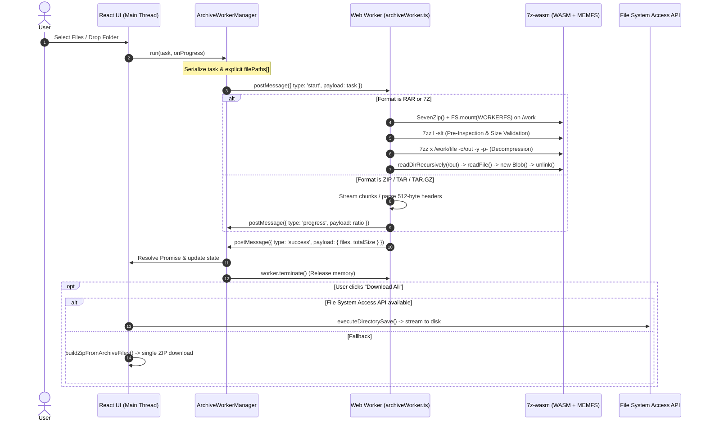

# BrowserDone — Archive Tools Architecture & Engineering Notes

**Scope:** Client-Side Architecture for Browser-Based Archive Tools (ZIP, TAR, TAR.GZ, RAR, 7Z)  
**Execution Environment:** Modern Desktop & Mobile Browsers (V8 / JavaScript / WebAssembly)  
**Security Model:** 100% Client-Side In-Memory / Sandboxed Processing (Zero Server-Side Uploads)

---

## 1. Core Architecture Principles

BrowserDone archive utilities operate entirely inside the client's web browser sandbox. No file payload, header, or directory structure is transmitted to any cloud or backend server.

1. **Main-Thread Isolation:** All CPU-heavy and memory-intensive decoding, decompression, and streaming operations execute inside Web Workers (`archiveWorker.ts`). The UI thread remains responsive for animations, cancellations, and progress reporting.
2. **Zero-Copy & Memory-Adaptive Streaming:** Where format specifications allow (ZIP and TAR), files are streamed in chunks or sliced via `Blob.slice()` to minimize in-memory heap duplication.
3. **Deterministic Structure Disambiguation:** Path collisions, duplicate archive entries, and file/directory ancestor conflicts are automatically and deterministically resolved without unhandled exceptions or silent data loss.
4. **POSIX UStar Compliance:** TAR and TAR.GZ generation adheres to POSIX UStar standards, supporting directory prefixes up to 155 bytes and filenames up to 100 bytes without requiring non-standard extensions for standard path depths.

---

## 2. Format Engines & Execution Matrix

| Archive Format | Operations Supported | Core Engine | Execution Context | Memory & I/O Strategy |
| :--- | :--- | :--- | :--- | :--- |
| **ZIP** (`.zip`) | Extraction & Creation | `fflate` (v0.8.3) | Web Worker (`archiveWorker.ts`) | **Extraction:** 64KB chunk streaming via `fflate.Unzip`. **Creation:** Asynchronous streaming via `fflate.Zip` into chunked Blob arrays. |
| **TAR** (`.tar`) | Extraction & Creation | Custom POSIX UStar Parser (`tarUtils.ts`) | Web Worker (`archiveWorker.ts`) | **Extraction:** Zero-copy slicing via `file.slice()` into Blob references. **Creation:** 512-byte block streaming directly to Blob accumulator. |
| **TAR.GZ** (`.tar.gz`) | Extraction & Creation | `fflate.Gunzip` + `tarUtils.ts` | Web Worker (`archiveWorker.ts`) | **Extraction:** Decompressed to intermediate stream/Blob, then sliced. **Creation:** TAR byte stream piped through `fflate.Gzip`. |
| **RAR** (`.rar`) | Extraction only | `7z-wasm` (v1.2.0, 32-bit WASM 7-Zip) | Web Worker (`archiveWorker.ts` / `rarAdapter.ts`) | Hybrid `WORKERFS` mount for input file + Emscripten `MEMFS` for extracted output. Synchronous C++ WASM execution. |
| **7Z** (`.7z`) | Extraction only | `7z-wasm` (v1.2.0, 32-bit WASM 7-Zip) | Web Worker (`archiveWorker.ts` / `sevenZipAdapter.ts`) | Hybrid `WORKERFS` mount for input file + Emscripten `MEMFS` for extracted output. Synchronous C++ WASM execution. |

---

## 3. Worker IPC & Communication Lifecycle

### IPC Data Integrity & The Structured Clone Boundary
* Standard `File` and `Blob` objects survive the browser's Structured Clone Algorithm during `postMessage` transfer.
* Non-standard expando properties (such as `file.webkitRelativePath` or custom `file.relativePath` assignments) are stripped during transfer.
* **Architecture Fix:** All creation pipelines construct an explicit serializable `filePaths?: string[]` array in the creation component or in `ArchiveWorkerManager.run()`, ensuring path preservation across Web Worker threads.

---

## 4. Directory Traversal & Folder Compression Architecture

Folder compression across ZIP, TAR, and TAR.GZ relies on `src/core/ui/Dropzone.tsx` and `src/core/archive-engine/folderTraversal.ts`:

1. **Native Directory Picker:** An explicit "Select Folder" button activates `<input type="file" webkitdirectory directory multiple>`, capturing true relative directory hierarchies from local disks.
2. **Recursive Drag-and-Drop:** Dropping folders uses `webkitGetAsEntry()` and recursive traversal via `FileSystemDirectoryReader.readEntries()`. Paginated reading ensures folders containing hundreds of items are fully captured without silent truncation.
3. **Collision Disambiguation (`sanitizeArchiveFiles`):**
   - Files with identical basenames residing in different directories retain their distinctive paths (e.g. `assets/icon.png` vs `docs/icon.png`).
   - If identically named files collide at the root, a reservation set dynamically assigns the next available sequential suffix (`Screenshot (2).png`), avoiding clobbering.
4. **Zero-Byte File Fidelity:** Legitimate zero-byte files (such as `.gitkeep`, empty placeholders) are preserved rather than dropped, with an informative user warning.

---

## 5. Extraction Virtual Tree & Downloader Architecture

Extracted archive payloads are unified under a single architecture:

1. **Virtual Tree Normalization (`archiveTree.ts`):**
   - All five format extractors feed into `buildArchiveVirtualTree()`.
   - The tree builds a nested in-memory node graph of folders and files.
   - **Disambiguation:** If an archive contains duplicate complete paths or ancestor conflicts (e.g., a file `docs` and a folder `docs/report.txt`), the engine automatically disambiguates node keys (`docs (1)`) without crashing or losing data.
   - **Quarantine:** Malformed entries or traversal attempts are safely isolated under `_quarantine/` with localized warning badges rendered in `ArchiveExplorer.tsx`.
2. **Batch Export Strategies:**
   - **Directory Save (Primary):** Leverages Chromium's `showDirectoryPicker()`. Writes files directly to local disk following user consent.
   - **Download All as ZIP (Fallback):** Generates an in-memory ZIP package via `buildZipFromArchiveFiles()`, strictly replicating the virtual tree hierarchy.

---

## 6. Known Resource Boundaries & Diagnostic Insights

For large archives on Windows systems, the following architectural constraints and failure modes have been analyzed:

1. **32-Bit WebAssembly 2GB Memory Ceiling:** `7zz.wasm` is bounded by a 32-bit linear memory descriptor (max 32,768 pages = 2,048MB). Under Windows address-space fragmentation, allocations exceeding ~1.2GB–1.4GB trigger out-of-memory worker termination.
2. **Emscripten MEMFS Buffer Accumulation:** Decompressing large RAR/7Z archives via `callMain` places the entire uncompressed output into memory at once before individual files can be extracted and unlinked.
3. **Windows `MAX_PATH` (260 Characters):** File System Access API calls on Windows fail with `DOMException` if target directory paths exceed 260 characters during directory export.
4. **Main-Thread ZIP Buffering:** Synchronous `buildZipFromArchiveFiles` on the UI thread for gigabyte-scale archives risks UI freezes; offloading batch ZIP creation to Web Workers is planned for future releases.
