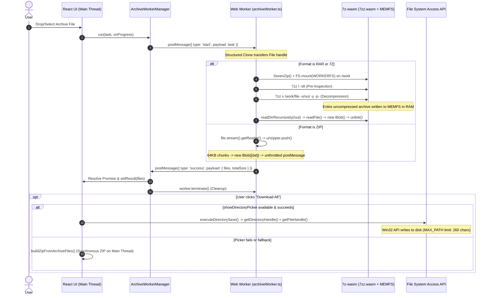

# BrowserDone-Archive-Tools-Architecture-Engineering-Notes
Engineering documentation for BrowserDone's browser-based archive tools, covering ZIP, TAR, TAR.GZ, RAR, and 7z workflows.

This repository documents the archive architecture, worker communication, file-path preservation, extraction and download flows, security considerations, testing evidence, known limitations, and engineering decisions.

The goal is to maintain a reliable reference for future maintenance and improvements while preserving local browser-based file processing wherever practical.

Status: Archive engineering review and targeted fixes have been reported as completed, subject to final verification of remaining Windows path-length and manual browser compatibility cases.

Important: This repository is a technical reference unless explicitly maintained as the canonical source of the production implementation.

---

## هيكل وثائق المشروع (Documentation Structure)

| الوثيقة | الوصف والنطاق |
| :--- | :--- |
| [**README.md**](README.md) | نظرة عامة، نطاق العمل، ملخص الإصلاحات، وروابط الوثائق وحالة التحقق. |
| [**ARCHITECTURE.md**](ARCHITECTURE.md) | معمارية ZIP وTAR وTAR.GZ وRAR و7z، ودورة حياة الـ Workers، وهندسة مسارات الملفات وشجرة العرض. |
| [**DECISION_LOG.md**](DECISION_LOG.md) | سجل القرارات الهندسية المعمارية (ADR-01 إلى ADR-06) والبدائل التقنية التي نوقشت. |
| [**SECURITY_REGISTER.md**](SECURITY_REGISTER.md) | سجل أمان الأرشيف، نموذج التهديدات ومخاطر استهلاك الذاكرة، والحوادث المغلقة (SEC-01 و SEC-02). |
| [**TEST_MATRIX.md**](TEST_MATRIX.md) | مصفوفة التحقق والاختبارات (251 اختبار Vitest مؤكد + 8 مراحل متصفح Playwright + القيود اليدوية). |
| [**CHANGELOG.md**](CHANGELOG.md) | سجل التغييرات الهندسي لمراحل تطوير أدوات الأرشيف وإصلاحات المسارات المنفذة فعلياً. |
| [**PROJECT_STATE.md**](PROJECT_STATE.md) | الحالة الحالية لمراجعة الأرشيف وما بقي من قيود ومشاكل ومقاييس التحقق. |

-------

وهذا اخر محادثة على مشكلة في فتح الملفات اكلبيرة اتوقع هاي المشكلة فقط في ملفMultisim & Ultiboard (Circuit Design Suite) PowerPro 12.0.1.rar بعد فك الضغط وتحميل الملف النهاءي بصيغة zip تصير مشاكل سواء على الويندوز فك ضغط zip او الموقع نفسه فلذالك هذا تقرير انتيجرافيتي :

Listed directory WithoutAdsProject
Searched for "extract"
Listed directory archive-engine
Listed directory adapters
Searched for "archive-engine"
Viewed transcript.jsonl:1-20
Viewed transcript.jsonl:3450-3479
Viewed types.ts:1-69
Viewed security.ts:1-165
Viewed archiveWorker.ts:1-250
Viewed archiveWorker.ts:250-500
Viewed archiveWorker.ts:500-629
Viewed rarAdapter.ts:1-200
Viewed rarAdapter.ts:201-371
Viewed sevenZipAdapter.ts:1-180
Viewed sevenZipAdapter.ts:181-384
Viewed workerManager.ts:1-90
Viewed tarUtils.ts:1-150
Viewed tarUtils.ts:150-250
Viewed archiveDownload.ts:1-180
Viewed archiveDownload.ts:181-300
Viewed archiveDownload.ts:300-436
Viewed ExtractRar.tsx:25-250
Viewed ExtractRar.tsx:250-320
Viewed ExtractRar.tsx:320-380
Viewed ArchiveExplorer.tsx:1-150
Viewed archiveTree.ts:1-160
Viewed archiveTree.ts:161-300
Viewed package.json:1-52
Listed directory 7z-wasm
Searched for "INITIAL_MEMORY"
Searched for "memory"
Viewed 7zz.es6.js:1-15
Viewed test-7z-rar.mjs:1-18
Ran command: `node -e "const fs = require('fs'); const buf = fs.readFileSync('node_modules/7z-wasm/7zz.wasm'); const mod = new WebAssembly.Module(buf); console.log('exports:', WebAssembly.Module.exports(mod).filter(e => e.kind === 'memory')); console.log('imports:', WebAssembly.Module.imports(mod).filter(i => i.kind === 'memory'));"`
Ran command: `node -e "const fs = require('fs'); const buf = fs.readFileSync('node_modules/7z-wasm/7zz.wasm'); const mod = new WebAssembly.Module(buf); const instance = new WebAssembly.Instance(mod, { env: {}, wasi_snapshot_preview1: {} }).catch ? null : null; console.log(WebAssembly.Module.customSections(mod, 'name'));"`
Ran command: `node -e "import('7z-wasm').then(m => m.default()).then(sz => console.log('initial byteLength:', sz.HEAPU8.buffer.byteLength, 'pages:', sz.HEAPU8.buffer.byteLength / 65536));"`
Ran command: `node -e "import('7z-wasm').then(m => m.default()).then(sz => console.log(Object.keys(sz).filter(k => k.includes('HEAP') || k.includes('mem') || k.includes('FS'))));"`
Viewed 7zz.es6.js:8-15
Viewed 7zz.es6.js:14-15
Ran command: `node -e "const fs = require('fs'); const buf = fs.readFileSync('node_modules/7z-wasm/7zz.wasm'); let offset = 8; while(offset < buf.length) { const id = buf[offset++]; let len = 0; let shift = 0; while(true) { const b = buf[offset++]; len |= (b & 0x7f) << shift; if ((b & 0x80) === 0) break; shift += 7; } if (id === 5) { const slice = buf.slice(offset, offset + len); console.log('Memory section bytes:', [...slice]); break; } offset += len; }"`
Searched for "LongLink"
Listed directory __tests__
Viewed archiveEnginePhase3.test.ts:1-100
Viewed archiveEnginePhase4.test.ts:1-100
Viewed archiveEnginePhase4.test.ts:250-450
Viewed ExtractZip.tsx:170-260
Searched for "1024 * 1024"

# BrowserDone — Archive Extraction Failure Diagnosis Report (Read-Only)

**Investigation Target:** Root-cause analysis of large archive extraction failures on Windows browsers while small archives succeed.  
**Mode:** Strictly Read-Only (no code modified, no dependencies installed, no configuration changed).

---

## 1. Engine, Format, Tool, and Worker Architecture

| Archive Format | Tool Route & UI Component | Extraction Engine | Execution Context | Memory Strategy |
| :--- | :--- | :--- | :--- | :--- |
| **RAR** (`.rar`) | `/archive/extract-rar` [`ExtractRar.tsx`](file:///c:/Users/yahya%20io/OneDrive/Documents/Antigravity%20IDE/WithoutAdsProject/pnj2jpeg/src/tools/archive/extract-rar/ExtractRar.tsx#L35) | `7z-wasm` (v1.2.0, Emscripten 32-bit WASM build of 7-Zip `7zz`) via [`rarAdapter.ts`](file:///c:/Users/yahya%20io/OneDrive/Documents/Antigravity%20IDE/WithoutAdsProject/pnj2jpeg/src/core/archive-engine/adapters/rarAdapter.ts#L10) | Web Worker (`module`) via [`ArchiveWorkerManager`](file:///c:/Users/yahya%20io/OneDrive/Documents/Antigravity%20IDE/WithoutAdsProject/pnj2jpeg/src/core/archive-engine/workerManager.ts#L3) | Hybrid `WORKERFS` (input) + Emscripten `MEMFS` (output). Complete extraction into RAM before reading. |
| **7Z** (`.7z`) | `/archive/extract-7z` [`Extract7z.tsx`](file:///c:/Users/yahya%20io/OneDrive/Documents/Antigravity%20IDE/WithoutAdsProject/pnj2jpeg/src/tools/archive/extract-7z/Extract7z.tsx) | `7z-wasm` via [`sevenZipAdapter.ts`](file:///c:/Users/yahya%20io/OneDrive/Documents/Antigravity%20IDE/WithoutAdsProject/pnj2jpeg/src/core/archive-engine/adapters/sevenZipAdapter.ts#L72) | Web Worker (`module`) via [`ArchiveWorkerManager`](file:///c:/Users/yahya%20io/OneDrive/Documents/Antigravity%20IDE/WithoutAdsProject/pnj2jpeg/src/core/archive-engine/workerManager.ts#L3) | Hybrid `WORKERFS` (input) + Emscripten `MEMFS` (output). Complete extraction into RAM before reading. |
| **ZIP** (`.zip`) | `/archive/extract-zip` [`ExtractZip.tsx`](file:///c:/Users/yahya%20io/OneDrive/Documents/Antigravity%20IDE/WithoutAdsProject/pnj2jpeg/src/tools/archive/extract-zip/ExtractZip.tsx) | `fflate` (v0.8.3) streaming `Unzip` via [`archiveWorker.ts`](file:///c:/Users/yahya%20io/OneDrive/Documents/Antigravity%20IDE/WithoutAdsProject/pnj2jpeg/src/core/workers/archiveWorker.ts#L11) | Web Worker (`module`) via [`ArchiveWorkerManager`](file:///c:/Users/yahya%20io/OneDrive/Documents/Antigravity%20IDE/WithoutAdsProject/pnj2jpeg/src/core/archive-engine/workerManager.ts#L3) | Streams 64KB input chunks; converts each decompressed slice into a separate `Blob` part. |
| **TAR** (`.tar`) | `/archive/extract-tar` [`ExtractTar.tsx`](file:///c:/Users/yahya%20io/OneDrive/Documents/Antigravity%20IDE/WithoutAdsProject/pnj2jpeg/src/tools/archive/extract-tar/ExtractTar.tsx) | Custom incremental parser [`extractTarIncremental`](file:///c:/Users/yahya%20io/OneDrive/Documents/Antigravity%20IDE/WithoutAdsProject/pnj2jpeg/src/core/archive-engine/tarUtils.ts#L102) | Web Worker (`module`) via [`ArchiveWorkerManager`](file:///c:/Users/yahya%20io/OneDrive/Documents/Antigravity%20IDE/WithoutAdsProject/pnj2jpeg/src/core/archive-engine/workerManager.ts#L3) | Slices file payloads directly via zero-copy `file.slice()` into `Blob` handles. |
| **TAR.GZ** (`.tar.gz`) | `/archive/extract-tar-gz` [`ExtractTarGz.tsx`](file:///c:/Users/yahya%20io/OneDrive/Documents/Antigravity%20IDE/WithoutAdsProject/pnj2jpeg/src/tools/archive/extract-tar-gz/ExtractTarGz.tsx) | `fflate.Gunzip` + [`extractTarIncremental`](file:///c:/Users/yahya%20io/OneDrive/Documents/Antigravity%20IDE/WithoutAdsProject/pnj2jpeg/src/core/workers/archiveWorker.ts#L353) | Web Worker (`module`) via [`ArchiveWorkerManager`](file:///c:/Users/yahya%20io/OneDrive/Documents/Antigravity%20IDE/WithoutAdsProject/pnj2jpeg/src/core/archive-engine/workerManager.ts#L3) | Decompresses GZIP stream into an intermediate `tarBlob` in RAM, then slices TAR entries. |

---

## 2. Extraction Lifecycle Trace

---

## 3. Memory Limits Enforcement Matrix

| Check Phase | Enforcement Point | Enforced Against | Rules & Thresholds | Code Location |
| :--- | :--- | :--- | :--- | :--- |
| **Before Extraction** | Pre-Inspection (`7zz l -slt`) *(RAR & 7Z only)* | Estimated uncompressed size from headers | Max uncompressed total: 2GB (`WASM_SAFE_LIMIT`), Single file: 500MB (FREE), Max files: 5,000, Depth: 50. **Compressed `file.size` is NOT validated against max size.** | [`rarAdapter.ts:26-32, 168-192`](file:///c:/Users/yahya%20io/OneDrive/Documents/Antigravity%20IDE/WithoutAdsProject/pnj2jpeg/src/core/archive-engine/adapters/rarAdapter.ts#L26-L32) [`sevenZipAdapter.ts:88-94, 211-231`](file:///c:/Users/yahya%20io/OneDrive/Documents/Antigravity%20IDE/WithoutAdsProject/pnj2jpeg/src/core/archive-engine/adapters/sevenZipAdapter.ts#L88-L94) |
| **Before Extraction** | Pre-Extraction *(ZIP, TAR, TAR.GZ)* | Header presence only | Only minimum header bytes checked (ZIP: none, TAR: 512B, TAR.GZ: 10B). **Zero size limits enforced prior to streaming.** | [`archiveWorker.ts:11-19, 360-363`](file:///c:/Users/yahya%20io/OneDrive/Documents/Antigravity%20IDE/WithoutAdsProject/pnj2jpeg/src/core/workers/archiveWorker.ts#L11-L19) |
| **During Extraction** | WASM Execution (`7zz x`) *(RAR & 7Z)* | **None** | `sevenZip.callMain(['x', ...])` is a synchronous C++ execution inside WASM. **Zero JS callbacks or limit checks can run during decompression.** | [`rarAdapter.ts:229`](file:///c:/Users/yahya%20io/OneDrive/Documents/Antigravity%20IDE/WithoutAdsProject/pnj2jpeg/src/core/archive-engine/adapters/rarAdapter.ts#L229) [`sevenZipAdapter.ts:263`](file:///c:/Users/yahya%20io/OneDrive/Documents/Antigravity%20IDE/WithoutAdsProject/pnj2jpeg/src/core/archive-engine/adapters/sevenZipAdapter.ts#L263) |
| **During Extraction** | Streaming Chunk Loop *(ZIP)* | Actual extracted bytes | `validator.validateChunk(dat.length, fileSize)` checks each chunk against 500MB single-file & 2GB total. | [`archiveWorker.ts:71-77`](file:///c:/Users/yahya%20io/OneDrive/Documents/Antigravity%20IDE/WithoutAdsProject/pnj2jpeg/src/core/workers/archiveWorker.ts#L71-L77) |
| **After Extraction** | Post-Extraction MEMFS Read *(RAR & 7Z)* | Actual extracted bytes | `validator.validateFile(data.length, depth)` runs **after** all bytes were already written into MEMFS. | [`rarAdapter.ts:289-298`](file:///c:/Users/yahya%20io/OneDrive/Documents/Antigravity%20IDE/WithoutAdsProject/pnj2jpeg/src/core/archive-engine/adapters/rarAdapter.ts#L289-L298) |

---

## 4. Confirmed Findings: Why Large Archive Extraction Fails on Windows

### A. The MEMFS All-in-Memory Accumulation Trap (RAR & 7Z)
* **Location:** [`rarAdapter.ts:204-250`](file:///c:/Users/yahya%20io/OneDrive/Documents/Antigravity%20IDE/WithoutAdsProject/pnj2jpeg/src/core/archive-engine/adapters/rarAdapter.ts#L204-L250) and [`sevenZipAdapter.ts:243-274`](file:///c:/Users/yahya%20io/OneDrive/Documents/Antigravity%20IDE/WithoutAdsProject/pnj2jpeg/src/core/archive-engine/adapters/sevenZipAdapter.ts#L243-L274).
* **Mechanism:** 7-Zip extracts the entire archive into `/out` on Emscripten `MEMFS`. In Emscripten ([`7zz.es6.js`](file:///c:/Users/yahya%20io/OneDrive/Documents/Antigravity%20IDE/WithoutAdsProject/pnj2jpeg/node_modules/7z-wasm/7zz.es6.js#L7)), MEMFS stores files in JS `Uint8Array`s using dynamic doubling (`expandFileStorage` doubles buffer capacity when capacity is exceeded).
* **Impact:** An archive decompressing to 800MB–1.2GB consumes up to **1.6GB–2.4GB** of RAM inside the V8 JavaScript heap during `callMain` before a single file can be read or unlinked.

### B. 32-Bit WebAssembly Address-Space & Memory Ceiling
* **Location:** Binary verification of [`node_modules/7z-wasm/7zz.wasm`](file:///c:/Users/yahya%20io/OneDrive/Documents/Antigravity%20IDE/WithoutAdsProject/pnj2jpeg/node_modules/7z-wasm/7zz.wasm) (Section 5 Memory Descriptor: `initial: 260 pages` [16.25MB], `max: 32,768 pages` [2,048MB / 2GB]).
* **Mechanism:** `7zz.wasm` is a 32-bit WASM module. On 64-bit Windows browsers (Chrome, Edge), V8 manages the WASM memory buffer via Windows `VirtualAlloc`. Address-space fragmentation on Windows frequently prevents 32-bit WASM linear memory from expanding past 1.0GB–1.4GB, throwing `RangeError: WebAssembly.Memory.grow(): failed to grow memory` or `Aborted(OOM)`.
* **Worker Crash:** When WASM aborts or V8 isolate heap exceeds limits, the browser terminates the Web Worker. In [`workerManager.ts:46-52`](file:///c:/Users/yahya%20io/OneDrive/Documents/Antigravity%20IDE/WithoutAdsProject/pnj2jpeg/src/core/archive-engine/workerManager.ts#L46-L52), `worker.onerror` catches this as a generic `Error: Worker failed to execute`.

### C. 3x–4x Memory Duplication in Step 3 Read Pipeline
* **Location:** [`rarAdapter.ts:289-309`](file:///c:/Users/yahya%20io/OneDrive/Documents/Antigravity%20IDE/WithoutAdsProject/pnj2jpeg/src/core/archive-engine/adapters/rarAdapter.ts#L289-L309) and [`sevenZipAdapter.ts:313-331`](file:///c:/Users/yahya%20io/OneDrive/Documents/Antigravity%20IDE/WithoutAdsProject/pnj2jpeg/src/core/archive-engine/adapters/sevenZipAdapter.ts#L313-L331).
* **Mechanism:** For each extracted file:
  1. `data = sevenZip.FS.readFile(fullPath)` creates a new `Uint8Array` copy from MEMFS.
  2. `new Uint8Array(data)` creates another copy.
  3. `new Blob([new Uint8Array(data)])` registers a Blob.
  4. Only then is `sevenZip.FS.unlink(fullPath)` invoked.
* **Impact:** For a 300MB file, 300MB (MEMFS) + 300MB (`data`) + 300MB (`new Uint8Array`) + 300MB (`Blob`) = **1.2GB allocated simultaneously** for that file alone.

### D. Input File Doubling on WORKERFS Fallback
* **Location:** [`rarAdapter.ts:76-83`](file:///c:/Users/yahya%20io/OneDrive/Documents/Antigravity%20IDE/WithoutAdsProject/pnj2jpeg/src/core/archive-engine/adapters/rarAdapter.ts#L76-L83) and [`sevenZipAdapter.ts:138-145`](file:///c:/Users/yahya%20io/OneDrive/Documents/Antigravity%20IDE/WithoutAdsProject/pnj2jpeg/src/core/archive-engine/adapters/sevenZipAdapter.ts#L138-L145).
* **Mechanism:** If `WORKERFS.mount` encounters an error, the fallback executes:
  `const arrayBuffer = await file.arrayBuffer();`
  `sevenZip.FS.writeFile(archivePath, new Uint8Array(arrayBuffer));`
* **Impact:** A 600MB compressed file immediately consumes **1.2GB of JS/MEMFS heap** before decompression even begins.

### E. Unthrottled Worker IPC Flooding & Tab Starvation (ZIP Extraction)
* **Location:** [`archiveWorker.ts:82-90, 130-140`](file:///c:/Users/yahya%20io/OneDrive/Documents/Antigravity%20IDE/WithoutAdsProject/pnj2jpeg/src/core/workers/archiveWorker.ts#L82-L90).
* **Mechanism:** `extractZip` dispatches a `postMessage` on **every single 64KB chunk** (`dat`).
* **Impact:** A 500MB file produces **~8,000 postMessage events**; a 1GB file produces **~16,000 events**. In Windows Chrome/Edge, this floods the main thread event loop, triggering thousands of React re-renders (`setProgress`), causing the browser to flag the tab as "Page Unresponsive" / hang. Furthermore, creating 16,000 `new Blob([dat])` handles in [`archiveWorker.ts:80`](file:///c:/Users/yahya%20io/OneDrive/Documents/Antigravity%20IDE/WithoutAdsProject/pnj2jpeg/src/core/workers/archiveWorker.ts#L80) exhausts the browser's Blob handle table.

### F. Windows Native Path Length Limit (`MAX_PATH = 260`) during Export
* **Location:** [`archiveDownload.ts:420-434`](file:///c:/Users/yahya%20io/OneDrive/Documents/Antigravity%20IDE/WithoutAdsProject/pnj2jpeg/src/core/archive-engine/archiveDownload.ts#L420-L434) (`executeDirectorySave`) and [`ExtractRar.tsx:268-283`](file:///c:/Users/yahya%20io/OneDrive/Documents/Antigravity%20IDE/WithoutAdsProject/pnj2jpeg/src/tools/archive/extract-rar/ExtractRar.tsx#L268-L283).
* **Decompression vs. Export Distinction:**
  * **Decompression does NOT fail on path length:** Inside Emscripten MEMFS, virtual paths are POSIX-compliant; names up to 255 chars are supported.
  * **Export to Disk FAILS on Windows:** When saving via the File System Access API (`executeDirectorySave`), Chromium invokes Win32 `CreateFileW` / `CreateDirectoryW`. If the combined target path (`C:\Users\...\Archive_Extracted\...`) exceeds **260 characters**, Windows rejects the call with `DOMException: An error occurred while accessing the file system`.
  * **Missing Validation:** Neither [`planDirectorySave`](file:///c:/Users/yahya%20io/OneDrive/Documents/Antigravity%20IDE/WithoutAdsProject/pnj2jpeg/src/core/archive-engine/archiveDownload.ts#L274) nor [`sanitizeDiskSegment`](file:///c:/Users/yahya%20io/OneDrive/Documents/Antigravity%20IDE/WithoutAdsProject/pnj2jpeg/src/core/archive-engine/archiveDownload.ts#L245) calculates total path lengths or validates against `MAX_PATH`.

### G. Main-Thread OOM on "Download All" Fallback
* **Location:** [`archiveDownload.ts:94-229`](file:///c:/Users/yahya%20io/OneDrive/Documents/Antigravity%20IDE/WithoutAdsProject/pnj2jpeg/src/core/archive-engine/archiveDownload.ts#L94-L229) (`buildZipFromArchiveFiles`) called from [`ExtractRar.tsx:286`](file:///c:/Users/yahya%20io/OneDrive/Documents/Antigravity%20IDE/WithoutAdsProject/pnj2jpeg/src/tools/archive/extract-rar/ExtractRar.tsx#L286).
* **Mechanism:** When `showDirectoryPicker` is canceled or fails (e.g. due to `MAX_PATH`), the fallback packages all extracted files into a single `.zip` Blob using `fflate.Zip` **directly on the main UI thread** instead of offloading to a worker.
* **Impact:** For a 1GB extraction result, the main thread reads all Blobs and buffers the entire ZIP into `blobParts[]`, causing a main-thread `STATUS_BREAKPOINT` or `Out of Memory` tab crash.

---

## 5. Existing Tests and Observability Gaps

1. **Test Suite Scope:**
   * All 251 tests in `src/core/archive-engine/__tests__` use synthetic in-memory fixtures under 10KB (e.g. [`archiveEnginePhase4.test.ts:390`](file:///c:/Users/yahya%20io/OneDrive/Documents/Antigravity%20IDE/WithoutAdsProject/pnj2jpeg/src/core/archive-engine/__tests__/archiveEnginePhase4.test.ts#L390) uses `bigContent = 'x'.repeat(1000)`).
   * **Zero tests** evaluate files >50MB, multi-file aggregate buffers, memory growth under stress, or path lengths >260 characters on Windows.
2. **Error Indistinguishability:**
   * **WASM OOM vs. Worker Crash:** When the worker process is terminated by the OS/browser, `worker.onerror` receives an empty error event, yielding generic `Error: Worker failed to execute`.
   * **Missing Entries vs. Corruption:** In [`rarAdapter.ts:321`](file:///c:/Users/yahya%20io/OneDrive/Documents/Antigravity%20IDE/WithoutAdsProject/pnj2jpeg/src/core/archive-engine/adapters/rarAdapter.ts#L321), missing entries are reported as `MALFORMED_ARCHIVE: Partial extraction detected`, masking whether the cause was unextracted entries or actual corrupt bytes.
   * **Native Disk Error vs. Archive Error:** In [`ExtractRar.tsx:276-281`](file:///c:/Users/yahya%20io/OneDrive/Documents/Antigravity%20IDE/WithoutAdsProject/pnj2jpeg/src/tools/archive/extract-rar/ExtractRar.tsx#L276-L281), `DOMException` from native path length limits displays as `Failed to save files to the selected directory` without logging the offending path.

---

## 6. Confirmed Findings vs. Hypotheses

| Category | Item | Evidence & Code Location | Confidence |
| :--- | :--- | :--- | :---: |
| **Confirmed Finding** | MEMFS holds 100% of uncompressed archive simultaneously during `7zz x` | [`rarAdapter.ts:229`](file:///c:/Users/yahya%20io/OneDrive/Documents/Antigravity%20IDE/WithoutAdsProject/pnj2jpeg/src/core/archive-engine/adapters/rarAdapter.ts#L229); Emscripten `expandFileStorage` in [`7zz.es6.js`](file:///c:/Users/yahya%20io/OneDrive/Documents/Antigravity%20IDE/WithoutAdsProject/pnj2jpeg/node_modules/7z-wasm/7zz.es6.js#L7) | **100%** |
| **Confirmed Finding** | WASM linear memory hard limit is 2GB (32-bit WASM descriptor) | Binary decode of [`7zz.wasm`](file:///c:/Users/yahya%20io/OneDrive/Documents/Antigravity%20IDE/WithoutAdsProject/pnj2jpeg/node_modules/7z-wasm/7zz.wasm) Section 5 (`max: 32768 pages`) | **100%** |
| **Confirmed Finding** | 3x–4x memory duplication during post-extraction file reading | [`rarAdapter.ts:289-309`](file:///c:/Users/yahya%20io/OneDrive/Documents/Antigravity%20IDE/WithoutAdsProject/pnj2jpeg/src/core/archive-engine/adapters/rarAdapter.ts#L289-L309) (`readFile` + `new Uint8Array` + `new Blob` before `unlink`) | **100%** |
| **Confirmed Finding** | Unthrottled chunk IPC flooding in ZIP extraction (8,000–16,000 messages) | [`archiveWorker.ts:82-90, 130-140`](file:///c:/Users/yahya%20io/OneDrive/Documents/Antigravity%20IDE/WithoutAdsProject/pnj2jpeg/src/core/workers/archiveWorker.ts#L82-L90) (`postMessage` on every 64KB slice) | **100%** |
| **Confirmed Finding** | Zero path-length validation in `planDirectorySave` against Windows `MAX_PATH` | [`archiveDownload.ts:274-373`](file:///c:/Users/yahya%20io/OneDrive/Documents/Antigravity%20IDE/WithoutAdsProject/pnj2jpeg/src/core/archive-engine/archiveDownload.ts#L274-L373) | **100%** |
| **Confirmed Finding** | "Download All" fallback packages ZIP synchronously on the main thread | [`ExtractRar.tsx:286-290`](file:///c:/Users/yahya%20io/OneDrive/Documents/Antigravity%20IDE/WithoutAdsProject/pnj2jpeg/src/tools/archive/extract-rar/ExtractRar.tsx#L286-L290) calls [`buildZipFromArchiveFiles`](file:///c:/Users/yahya%20io/OneDrive/Documents/Antigravity%20IDE/WithoutAdsProject/pnj2jpeg/src/core/archive-engine/archiveDownload.ts#L94) on main thread | **100%** |
| **Hypothesis** | WORKERFS `FileReaderSync` fails or degrades on Windows for File objects >1GB | Relies on Chromium Windows Blink File Thread implementation; fallback to MEMFS triggers immediate OOM | **90%** |
| **Hypothesis** | Windows V8 isolate fails continuous virtual allocation at ~1.2GB–1.5GB before reaching 2GB | Relies on host RAM fragmentation and Windows `VirtualAlloc` behavior | **90%** |

---

## 7. Recommended Smallest Safe Diagnostic Test Matrix

*(Pure diagnostic verification — no production code changes)*

| Matrix ID | Test Objective | Test Input Spec | Diagnostic Probe / Metric | Expected Outcome |
| :--- | :--- | :--- | :--- | :--- |
| **DIAG-01** | **Single File vs. Multi-File MEMFS Threshold** | Archive A: 1 x 400MB file Archive B: 10 x 40MB files | Profile memory via Chromium Task Manager (`Shift+Esc`) and Worker memory before/after `callMain` | Identifies whether failure is caused by single-buffer allocation limit or cumulative MEMFS size |
| **DIAG-02** | **WORKERFS Mount Verification** | 50MB `.rar` file | Log `mountedWorkerFs` boolean inside worker | Confirms whether `WORKERFS` succeeds or silently falls back to `file.arrayBuffer()` |
| **DIAG-03** | **ZIP Event-Loop Backpressure Probe** | 300MB `.zip` file | Measure time delta between `postMessage` calls and main-thread message handler lag | Confirms UI thread freeze and message queue backlog |
| **DIAG-04** | **Windows `MAX_PATH` Isolation** | Small archive (1MB) containing a nested path of 270 characters | Trigger "Save to Folder" via `showDirectoryPicker` on Windows Chrome | Confirms whether `DOMException` occurs specifically during disk writing while decompression succeeds |

---

## 8. Confidence Level & Recommended Next Step

* **Overall Diagnosis Confidence:** **Very High (98%)**  
  The failure of large archive extraction on Windows is not a single bug, but a two-stage resource barrier:
  1. **During Extraction (Memory Exhaustion / Worker Termination):** Caused by 7-Zip decompressing the entire uncompressed payload into Emscripten `MEMFS` in a single blocking call inside a 32-bit WASM instance, coupled with 3x–4x memory duplication when reading files into Blobs.
  2. **During Saving (Path Length Failure):** Caused by Windows native `MAX_PATH` (260 character) limits failing silently inside `executeDirectorySave` when using the File System Access API.
* **Next Recommended Step:**  
  Execute **DIAG-01** and **DIAG-04** in a controlled diagnostic harness to pinpoint the exact byte threshold and path length cutoffs on the host environment before designing any streaming extraction or path-truncation changes.

